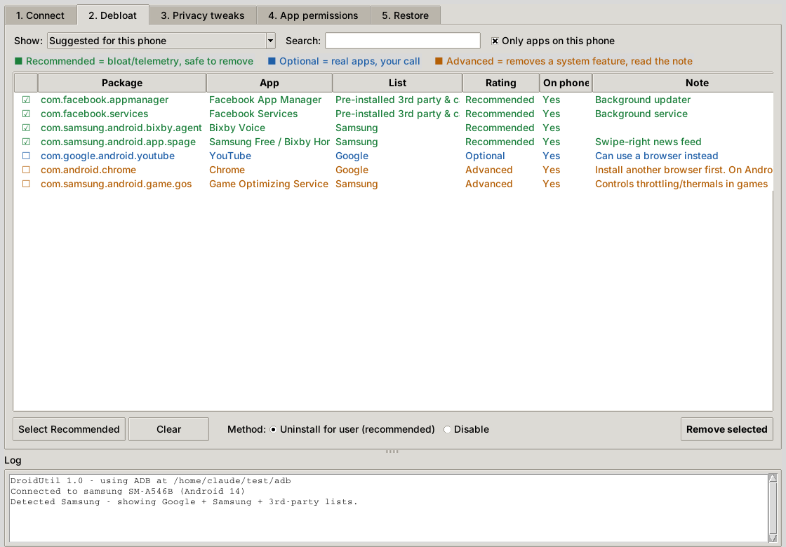
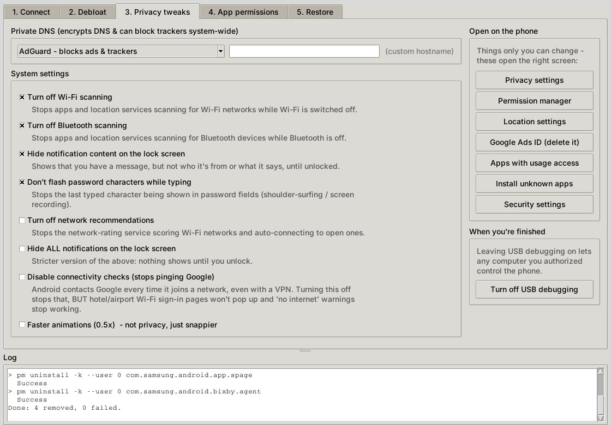
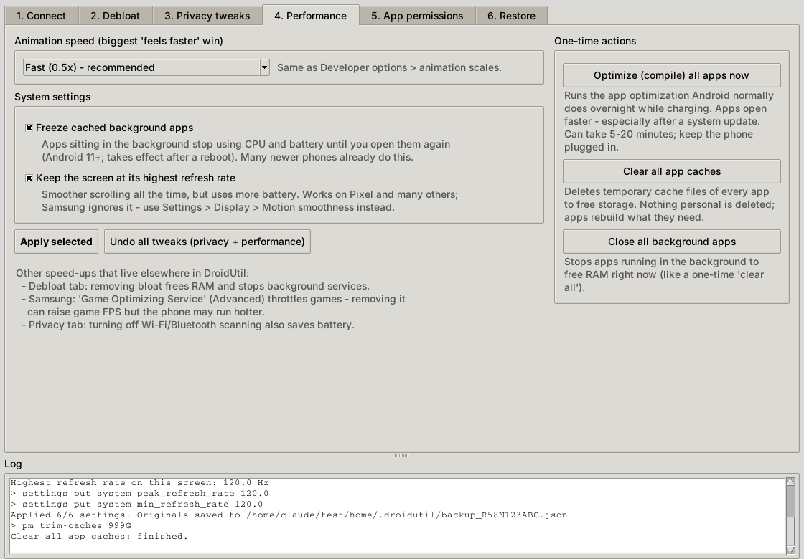
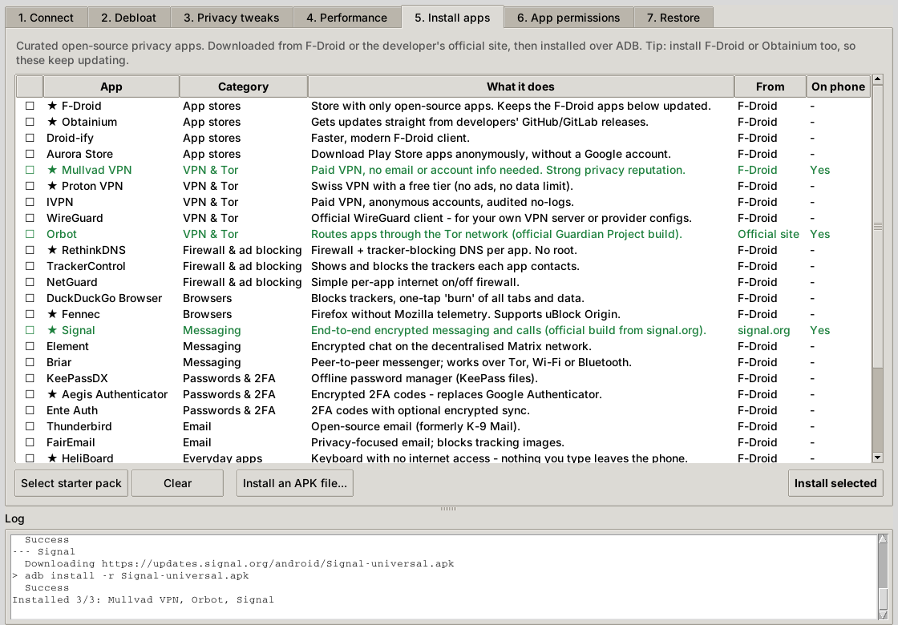

# DroidUtil: privacy & debloat for any Android phone

A WinUtil-style desktop app for Android. It runs on your Windows, Mac or Linux computer, connects to the phone over **ADB** (USB or wireless debugging), and doesn't need root. Everything it does can be undone.

## What it does

| Tab | What you get |
|---|---|
| **1. Connect** | Finds ADB, or downloads Google's official copy for you. Supports USB and wireless (Android 11+) pairing. Includes a **Dry run** mode that shows every command without running it. |
| **2. Debloat** | Detects the phone's brand (Samsung, Xiaomi/Redmi/POCO, OnePlus/OPPO/Realme, Motorola, Pixel/Google) and lists only the bloat that is actually on *your* phone. Each item is rated **Recommended / Optional / Advanced**. "Select Recommended" is the one-click safe preset. An expert view lists every other installed app. |
| **3. Privacy tweaks** | Private DNS (AdGuard, Mullvad, Quad9, Cloudflare or your own), Wi-Fi/Bluetooth scanning off, hidden lock-screen notification content, password characters not flashed while typing, network recommendations off, optional connectivity-check off, Also has buttons that open the phone's own privacy screens (Ads ID, location, permission manager…) and a button to turn off USB debugging when you're done. |
| **4. Performance** | Animation speed (0.5x / off), freezing cached background apps, locking the screen to its highest refresh rate. One-time actions: optimize (compile) all apps, clear all app caches, close all background apps. |
| **5. Install apps** | 29 curated open-source privacy apps: VPNs (Mullvad, Proton VPN, IVPN, WireGuard, Orbot/Tor), firewalls and ad blockers (RethinkDNS, TrackerControl, NetGuard), Signal, Aegis, KeePassDX, Fennec, HeliBoard, F-Droid/Obtainium and more. Apps are downloaded from F-Droid or the developer's official site, the build matching your phone's CPU type is chosen automatically, and Signal's download is SHA-256 checked. Click "Select starter pack" for the ★ picks, or use "Install an APK file…" for anything else. |
| **6. App permissions** | Scans the apps you installed and lists which ones hold location (including background location), microphone, camera, contacts, SMS, call-log and other sensitive permissions. Tick and revoke. |
| **7. Restore** | Shows every system app that is currently removed or disabled, and puts any of them back with one click. |

## Run it

1. **Install Python 3.8+ with Tk**:
   - Windows: `winget install Python.Python.3.12` (or python.org)
   - macOS: python.org installer
   - Debian/Ubuntu: `sudo apt install python3 python3-tk adb`
   - Arch / Omarchy: `sudo pacman -S --needed python tk android-tools`
2. Double-click **`run.bat`** (Windows) or run `./run.sh` (macOS/Linux). You can also run `python droidutil.py` directly.
3. If ADB isn't installed, click **Download ADB from Google** on the Connect tab.

### Prepare the phone (one time)
1. *Settings → About phone →* tap **Build number** 7 times. (Xiaomi: tap "OS version". Samsung: it's under *Software information*.)
2. *Settings → System → Developer options →* turn on **USB debugging**. Xiaomi phones also need **USB debugging (Security settings)** turned on.
3. Plug the phone in with a data cable, tap **Allow** on the phone, then press **Refresh** in the app.

## How it stays safe
- **Uninstall for user** (`pm uninstall -k --user 0`) only hides the app for your user. The app is still in the read-only system partition, so it can always come back: use the Restore tab, or do a **factory reset**, which brings back *everything*.
- **Protected packages are never shown or touched.** These include SystemUI, Settings, Google Play Services, launchers, keyboards, the package installer, and MIUI Security Center. Removing these can bootloop the phone or lock you out.
- **Original values are saved before any setting changes.** "Undo all tweaks" puts them back. Backups are stored in `~/.droidutil/backup_<phone>.json`, along with a history of everything removed.
- Package names and setting values are validated before anything is sent to the phone.

## Good to know
- Removing apps can't touch Google Play Services. On a stock phone, Google telemetry mostly goes through Play Services. For a phone with no Google services you'd need a custom OS such as GrapheneOS or LineageOS.
- System updates can reinstall some removed apps. Just run the app again after a big update.
- Use the **Advanced** items one at a time, so that if a feature breaks you know which app caused it.
- To grow the debloat list, edit the `PACKAGES` table at the top of `droidutil.py`. Each line has the package name, the app name, a rating and a note.

For a much bigger community-maintained package list, see [UAD-ng](https://github.com/Universal-Debloater-Alliance/universal-android-debloater-next-generation). To debloat from the phone itself without a PC, try **Canta** (it uses Shizuku).

## Screenshots

| Privacy | Performance | Install apps |
|---|---|---|
|  |  |  |

## Disclaimer

Use at your own risk. Everything is reversible, but try **Dry run** first and remove Advanced items one at a time.
